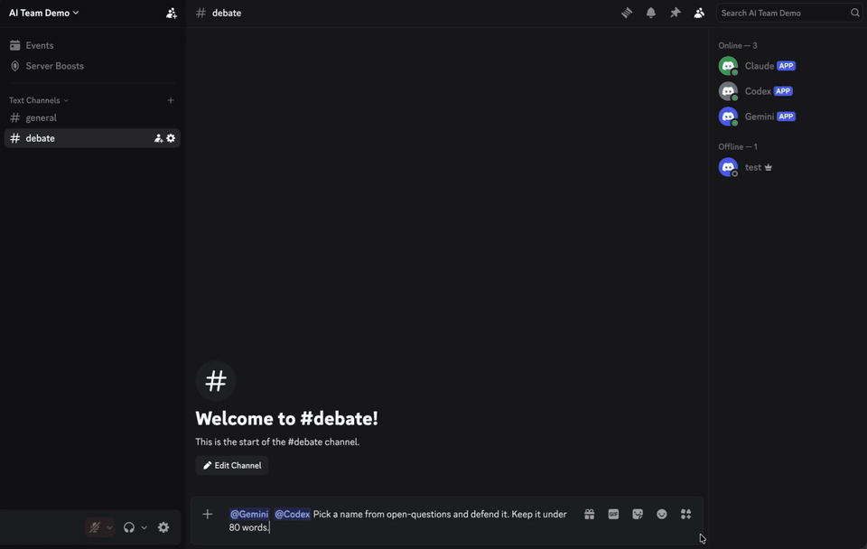
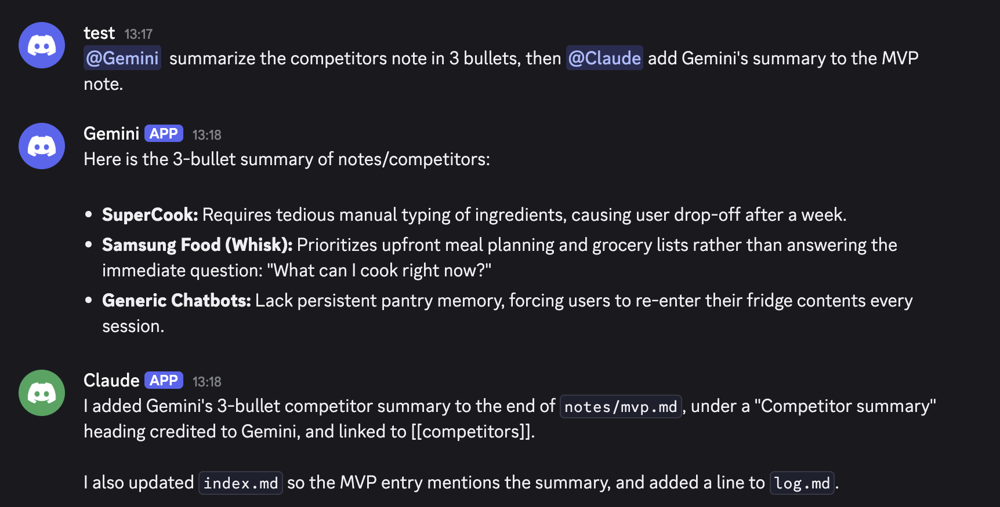
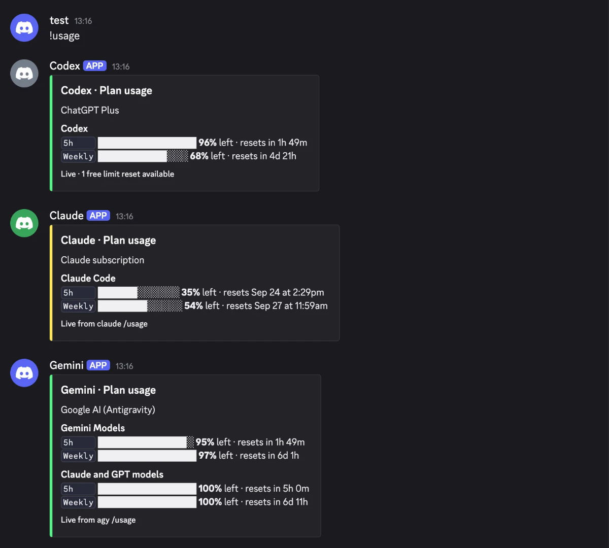
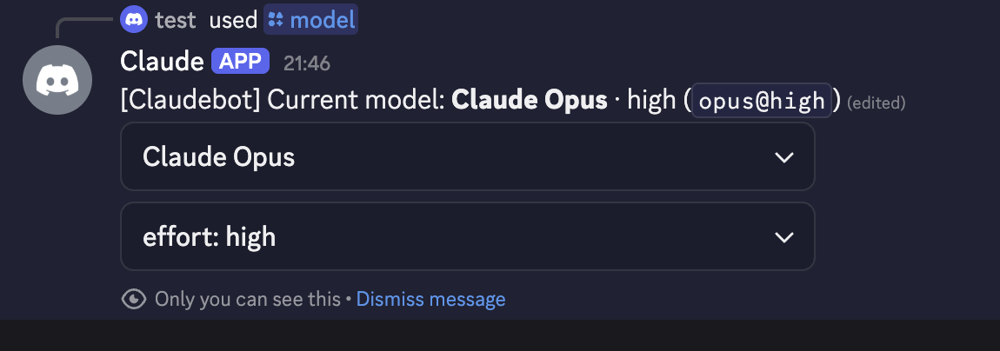

# Discord AI Team: Claude·ChatGPT·Gemini를 내 Discord에, API 키 없이

[English](README.md) · **한국어**

이미 Claude, ChatGPT, Gemini 중 하나 이상을 구독하고 있나요? 이 프로젝트는 그 구독을 내 Discord 서버의 AI 팀으로 바꿔줍니다. 폰에서 말을 걸 수 있고, AI들이 서로의 메시지를 읽고 토론까지 합니다.

- **API 키도, 토큰 요금도 없음:** 각 에이전트는 회사의 **공식 CLI를 내 계정 로그인(OAuth)으로** 실행합니다. 전부 지금 쓰는 요금제 안에서 돌아갑니다.
- **원하는 대로 조합:** 설정 파일 하나가 봇 하나입니다. 서로 다른 AI 셋, Claude 둘("작가"와 "비평가"), 또는 하나만 써도 됩니다.
- **규칙은 내가 정함:** 이름, 역할, 누가 쓸 수 있는지, 무엇을 건드릴 수 있는지(읽기 전용 / 수정 / 전체), 어디서 토론할지 모두 설정합니다.

| `PROVIDER` | AI | 실행하는 CLI | 필요한 구독 |
|---|---|---|---|
| `claude` | Claude | Claude Code (`claude -p`) | Claude Pro / Max |
| `codex` | ChatGPT | Codex CLI (`codex app-server`) | ChatGPT Plus / Pro |
| `gemini` | Gemini | Antigravity CLI (`agy -p`) | Google AI 요금제 |

<p align="center">
  
</p>



## 할 수 있는 것

- **어디서든 요청:** 채널에서 @멘션하거나 DM을 보내면 됩니다. 비공개 채널에 접근 가능한 AI 봇이 하나뿐이면 멘션 없이 말해도 답합니다. 봇은 내가 지정한 폴더(프로젝트, 노트 볼트 등)의 파일로 작업합니다.
- **사진 보내기:** 채널에서 봇을 멘션하며 사진을 첨부하거나 DM으로 사진을 보내면 분석합니다. PNG·JPEG·GIF·WebP를 한 메시지에 최대 4장, 각 20MB까지 받습니다.
- **문서 보내기:** PDF·TXT·DOCX·마크다운(`.md`, `.markdown`)·CSV를 첨부하면 본문을 읽습니다. 한 메시지에 최대 4개, 각 10MB까지 받습니다. 긴 문서는 파일당 25,000자, 전체 60,000자까지만 전달하며 PDF는 앞 30페이지만 읽습니다. 스캔본 PDF의 글자 인식(OCR)은 지원하지 않습니다.
- **AI끼리 일 넘기기:** `@gemini 노트 요약해줘, 그다음 @claude 그 요약을 계획에 추가해줘`라고 하면, 뒤에 멘션된 봇이 앞 봇의 답을 기다렸다가 이어서 작업합니다. 멘션받은 봇은 자기가 마지막으로 답한 뒤의 채널 메시지도 읽습니다. 다른 봇의 메시지도 포함됩니다.
- **토론시키기:** 서버 채널에서는 토론이 기본 ON입니다. 에이전트에게 다른 에이전트를 `@이름`으로 태그해 이어가라고 요청하면, 코드는 접근 가능한 에이전트의 이름을 실제 Discord 멘션으로 바꿉니다. 토론은 최대 4턴(채널별로 변경 가능) 전에 끝날 수도 있습니다. **Debate settings**에서 채널별로 끄고, **Stop all**로 진행 중인 토론을 바로 끝낼 수 있습니다.
- **한도 확인:** **All usage**은 모든 봇의 남은 5시간·주간 한도를 카드로 보여줍니다. 각 CLI에서 실시간으로 읽고, 한도를 쓰지 않습니다.
- **모델 바로 바꾸기:** **Model**을 누르면 모델과 추론 강도를 고르는 드롭다운이 뜨고, 각 AI의 CLI에서 모델 목록을 새로 읽습니다. CLI 자동 업데이트가 꺼져 있다면 CLI 업데이트 후 해당 봇을 재시작해 새 버전을 적용하세요. 선택값은 현재 채널에만 적용되며, 별도 선택이 없는 채널은 제공자의 기본 모델을 사용합니다.
- **Discord에서 설정 관리:** 각 봇의 **Agent settings**에서 이름, 서버·채널 프롬프트와 idle을 확인·수정합니다. 채널 공통 토론 설정은 어느 봇에서든 **Debate settings**로 관리합니다.
- **채널별 기억:** 채널마다 대화가 따로 이어지고, 재시작해도 유지됩니다. **New conversation**로 채널의 모든 에이전트를 새로 시작하고 **Resume**의 비공개 선택 메뉴에서 그 봇의 과거 Discord 대화를 골라 이어갑니다. **Rename**으로 대화에 이름을 붙일 수 있습니다.
- **긴 작업:** Claude와 Antigravity는 CLI에서 진행 이벤트가 오는 동안 계속 작업합니다. 30분 동안 유효한 진행 이벤트가 없을 때만 중단하며, **Agent settings**의 작업 사이 idle 시간과는 별개입니다. Claude는 작업 시작 시 대화를 저장하므로 중단 후에도 같은 채널에서 이어갈 수 있습니다. 타임아웃이 이미 실행한 명령이나 파일 변경을 되돌리지는 않으므로, 이어가기 전에 실제 상태를 확인하세요. 실패한 요청을 자동으로 재실행하지 않습니다.
- **작업 진행 상태 표시:** 직접 요청한 작업은 영어 상태 카드에 확인 가능한 진행 설명·도구 작업·경과 시간·대기 요청 수를 보여줍니다. **Stop**, **Stop all**, **Queue** 버튼을 제공하며, ChatGPT의 실행 중인 턴에는 **Send update**로 방향을 수정할 수 있습니다. 토론이 꺼진 채널에서는 답변 초안도 갱신합니다. 작업이 끝나면 진행 카드는 지우고 최종 답변에는 조작 버튼을 붙이지 않고 필요할 때 `/panel`로 엽니다. 봇끼리 이어가는 턴은 완성된 답변만 올립니다.
- **패널에서 모든 기능 조작:** 해당 봇의 `/panel`로 나에게만 보이는 패널을 열고, 사용 후 Dismiss message로 닫을 수 있습니다. 메인에는 **Agent settings**, **Model**, **Usage**, **New conversation**, **Resume**, **Rename**만 표시합니다. **Agent settings**에서 개인 완료 알림을 설정하며, 서버 관리자에게는 봇 관리 기능과 **Debate settings**도 표시합니다. 전체 한도는 **Usage → All usage**에서 확인합니다. 실행 중 카드에는 **Stop**, **Stop all**, **Queue**가 있고 일반 답변에는 버튼을 붙이지 않습니다. 슬래시 명령은 `/panel` 하나만 등록하고 **Apps → Ask**는 유지합니다. 인터페이스는 영어입니다.
- **선택형 질문:** 세 봇 모두 최대 3개의 질문을 선택 버튼·드롭다운·**Custom answer** 입력창으로 제시하고, 원래 요청자가 같은 채널에서 답하면 같은 대화로 이어갑니다. 질문·선택지·선택지 설명과 답변 후 이어지는 대화는 사용자의 대화 언어를 따르며, 고정 UI 문구는 영어를 유지합니다. 팝업은 버튼을 누른 뒤 열립니다. **Cancel task**·Stop·30분 질문 만료는 선택지를 자동으로 고르지 않고 대기를 끝냅니다. CLI가 보내는 Codex 기본 질문 이벤트도 연결합니다.
- **대기 요청 관리:** 작업 중 새 요청을 보내면 대기 안내와 **Cancel request** 버튼을 보여줍니다. 비공개 **Queue** 패널에서 자신의 대기 요청만 개별 취소할 수 있습니다. 상태 카드의 Stop은 해당 작업만 멈추고, 기존 **Stop**·**Stop all**은 대기 요청도 취소합니다. 재시작하면 진행 중인 작업과 질문 대기는 복구되지 않지만, 저장된 대화는 이어갈 수 있습니다.
- **완료 알림 선택:** **Agent settings → Completion alerts**는 이 채널에서 자신의 향후 작업에 적용할 설정이며, 1분 이상 걸린 작업만 알려줍니다. 기본 OFF이고 요청자만 멘션합니다. 인터페이스 문구는 영어입니다.
- **메시지에서 바로 호출:** 메시지를 우클릭하거나 길게 눌러 해당 봇의 **앱 → Ask**를 고르면 봇이 그 메시지와 첨부파일을 읽고 채널에 답합니다.
- **포워드:** 텍스트 메시지를 봇에게 포워드하면 읽습니다.

### 패널 조작

**All usage**은 실행 중인 봇들의 요금제 한도를 보여줍니다. 응답은 요청자에게만 보입니다.



**Model**에서 채널별로 모델과 추론 강도를 따로 고를 수 있습니다.

**Edit channel prompt**는 현재 채널의 모든 에이전트가 공유하는 프롬프트를 설정합니다. 저장하거나 지우면 기존 에이전트별 채널 프롬프트도 교체됩니다. **Edit server prompt**는 선택한 에이전트에만 적용됩니다.

서버 채널의 **New conversation**은 모든 에이전트의 현재 대화를 초기화하고 해당 채널의 진행 중 작업과 대기 요청을 취소합니다. 이전 메시지와 Debate 턴은 새 대화에 이어지지 않습니다. Debate·Auto participation·공통 채널 프롬프트·모델 선택값은 유지하며 다른 채널에는 영향을 주지 않습니다. 꺼져 있던 봇도 다시 켜면 초기화를 적용하고, 과거 대화는 Resume으로 다시 열 수 있습니다. DM에서는 선택한 봇만 초기화합니다.

**Agent settings → Channel auto participation**은 기본 OFF이며 현재 채널의 모든 에이전트에 공통 적용됩니다. 어느 에이전트의 패널에서든 한 번만 바꾸면 됩니다. 설정을 켠 뒤 새로 올라오는 메시지부터 적용됩니다. ON이면 태그 없는 메시지도 전달하고, **Edit channel prompt**로 언제 참여할지 정할 수 있습니다. 정확히 `[[SKIP]]`만 반환하면 글자가 나뉘어 도착해도 조용히 넘어갑니다. 참여 여부를 판단하는 동안에는 표시가 없고, 답변이나 도구 사용을 시작하면 일반 요청과 같은 입력 중 표시·진행 설명·도구 상태·제어 버튼을 보여줍니다. 진행 카드는 다른 에이전트를 호출하거나 Debate 턴을 소비하지 않습니다. 별도 판단 호출은 없지만 메시지를 읽는 데 모델 사용량은 듭니다. 다른 봇을 태그한 메시지는 해당 봇에게 맡깁니다. 태그 없는 봇 메시지에 답하려면 Debate ON이어야 하며, 태그로 이어진 답변과 같은 턴 제한을 따릅니다. Stop all 이후에는 사람이 명시적으로 재개하거나 에이전트를 태그할 때까지 자발적으로 다시 시작하지 않습니다. 기존 DM과 단독 비공개 채널 동작은 유지됩니다.



## 작동 구조

```
                 ┌─► bots/claude.env ─► claude -p   ─ 내 Claude 로그인  ─┐
Discord 서버 ────┼─► bots/codex.env  ─► codex app-server ─ ChatGPT 로그인 ─┼─► WORKSPACE_DIR
                 └─► bots/gemini.env ─► agy -p      ─ 내 Google 로그인  ─┘
```

모든 봇은 같은 작은 Node.js 프로그램(`src/bot.js` + `src/runner.js`)으로 돌아갑니다. Claude와 Antigravity는 대화별로 CLI 연결을 유지하고, Codex는 하나의 app-server 연결에서 대화별 요청을 처리합니다. 봇을 재시작해도 저장된 대화를 이어갈 수 있습니다. `src/providers/`에는 AI마다 파일이 하나씩 있습니다. 사진 첨부는 `state/attachments/`에 잠시 저장해 CLI가 읽게 하고, 답변이 끝나면 삭제합니다. 문서는 메모리에서 텍스트를 추출해 요청에 포함합니다. 실행 중인 봇은 `state/agents.json`에 자기를 등록하고, 토론할 때 이걸 보고 서로를 찾습니다.

## 준비물

- macOS 또는 Linux, Node.js 20.16~20.x 또는 22.3 이상 (`ctl.sh`는 zsh가 필요한데, macOS에는 기본으로 있습니다. Linux 서버에선 대신 systemd를 쓸 수 있습니다, 아래 참고)
- 쓰고 싶은 AI의 CLI 설치와 로그인 (1단계)
- 내가 관리하는 Discord 서버 (무료 비공개 서버면 충분)

## 설치

### 1. 각 CLI에 로그인 (최초 1회)

```bash
claude             # 요청하면 /login
codex login        # "Sign in with ChatGPT" 선택
agy                # 처음 실행하면 Google 로그인을 요청함, 로그인 후 종료
```

로그인 정보는 각 CLI가 보관합니다. 이 프로젝트는 비밀번호나 API 키를 전혀 다루지 않습니다.

### 2. 봇마다 Discord 봇 만들기

<https://discord.com/developers/applications>에서 봇마다 반복합니다.

1. **New Application**을 누르고 애플리케이션 이름을 정합니다. 봇 계정 이름은 **Bot** 탭이나 **Agent settings**에서 따로 바꿀 수 있습니다. Discord는 브랜드 이름에 `Bot`을 붙여도 거절할 수 있으므로, 그때는 다른 이름을 사용하세요.
2. **Bot** 탭 → **Reset Token** → 토큰을 복사합니다.
3. 같은 탭에서 **Message Content Intent**를 켭니다. 안 켜면 봇이 빈 메시지만 받습니다.
4. **OAuth2 → URL Generator**에서 범위는 `bot`과 `applications.commands`, 권한은 *View Channels, Send Messages, Read Message History, Embed Links, Add Reactions*를 고릅니다. 생성된 URL을 열어 서버에 초대합니다.

### 3. 채널 만들기

토론을 쓰려면 채널 권한에 봇 둘 이상을 추가하고 **채널 보기**, **메시지 보내기**, **메시지 기록 읽기**를 허용하세요. 토론은 기본 ON이며 **Debate settings**에서 기본값 적용 여부나 채널별 설정을 확인할 수 있습니다. 채널 ID는 복사할 필요가 없습니다. `ALLOWED_USER_IDS`를 설정한다면 **사용자 설정 → 고급 → 개발자 모드**를 켜고 내 이름을 우클릭해 **사용자 ID 복사하기**를 합니다.

채널마다 대화가 따로 쌓이니까, 봇별이 아니라 **주제별**로 채널을 만드세요. 예시:

| 채널 | 용도 | 봇끼리 토론 |
|---|---|---|
| `#general` | 일상 질문 | 기본 켬; 필요하면 끔 |
| `#project-x` | 프로젝트 하나, 맥락이 따로 쌓임 | 기본 켬; 필요하면 끔 |
| `#debate` | 질문 하나 던지고 토론시키기 | 접근 가능한 봇 둘 이상이면 기본 켬 |

**일단 써보고 싶다면:** 함께 들어 있는 예시를 이 폴더 밖으로 복사하고(`cp -r example-workspace ~/leftover-demo`), `WORKSPACE_DIR`를 그 복사본으로 지정하세요. 토큰이 이 저장소 안에 있으니, 봇이 저장소 안의 폴더를 보게 하면 안 됩니다. 가상의 사이드 프로젝트(냉장고 속 재료로 저녁을 추천하는 앱 "Leftover")의 노트와 공유 규칙이 들어 있어서, 봇들에게 미정 질문을 토론시켜 볼 수 있습니다. 봇의 작업 폴더를 다른 곳으로 설정했다면 `example-workspace`는 실행에 쓰이지 않습니다.

### 4. 설치

```bash
git clone https://github.com/angdulu/discord-ai-team
cd discord-ai-team
npm install
```

### 5. 봇마다 설정 파일 만들기

예시 파일을 복사하고, 복사본 이름은 마음대로 정합니다. **파일 이름이 곧 `ctl.sh`에서 쓰는 봇 이름입니다.**

```bash
cp bots/claude.env.example bots/claude.env
cp bots/codex.env.example  bots/codex.env
cp bots/gemini.env.example bots/gemini.env
chmod 600 bots/*.env
```

그다음 각 파일을 채웁니다. 모든 항목은 파일 안에 설명이 있습니다.

```ini
PROVIDER=claude                     # claude | codex | gemini
DISCORD_BOT_TOKEN=<토큰>
WORKSPACE_DIR=/내/폴더/경로
PERMISSIONS=read-only               # read-only | edit | full
ALLOWED_CHANNEL_IDS=                  # 비우면 봇이 접근 가능한 모든 채널
ALLOWED_USER_IDS=<내 사용자 id>      # 쓸 수 있는 사람, 비우면 그 채널의 누구나
```

Claude를 둘 쓰고 싶으면 `bots/writer.env`와 `bots/critic.env`를 만들고, 둘 다 `PROVIDER=claude`로 둡니다. Discord 봇 토큰은 각자 따로 씁니다.

### 6. 권한 고르기

| `PERMISSIONS` | 봇이 할 수 있는 것 | Claude | Codex | Gemini |
|---|---|---|---|---|
| `read-only` (기본) | `WORKSPACE_DIR` 파일 읽기 | 읽기·검색 도구만 사용 가능, 수정 도구와 셸 명령은 차단 | OS 샌드박스가 쓰기를 모두 차단 | 허용 목록에 없는 도구는 전부 거부¹ |
| `edit` | 읽기 + `WORKSPACE_DIR` 안에서 파일 생성·수정 | `acceptEdits` | `workspace-write` 샌드박스 | `--mode accept-edits`¹ |
| `full` | 제한 없음: 모든 명령, 모든 경로 | 권한 검사 전부 생략 | 샌드박스 없음 | 권한 검사 전부 생략 |

¹ Gemini는 파일 읽기도 `~/.gemini/antigravity-cli/settings.json`의 허용 규칙을 따릅니다. 볼트의 이미지와 Discord 사진을 읽으려면 아래 두 경로를 실제 절대 경로로 바꾸어 `permissions.allow`에 추가하세요:
`"read_file(/절대경로/WORKSPACE_DIR)"`, `"read_file(/절대경로/discord-ai-team/state/attachments)"`.

고르는 기준:
- **`edit`나 `full`을 쓸 땐 꼭 `ALLOWED_USER_IDS`를 설정하세요.** 봇을 쓸 수 있는 사람은 누구나 그 권한을 갖게 됩니다.
- **나 혼자 있는 서버:** `edit`가 무난합니다.
- **`full`:** 날아가도 괜찮은 폴더나 컴퓨터에서만 쓰세요. 한 단계씩 승인하는 사람이 없습니다.
- 거부된 게 있으면 답장 끝에 `⛔ Permission denied: …`가 붙습니다. 봇이 "했다"고 말하더라도 이 줄을 믿으세요.

### 7. 실행

```bash
npm run register-commands  # /panel과 Apps → Ask만 등록하고 다른 기존 명령 제거
./ctl.sh start all        # 또는: ./ctl.sh start claude
./ctl.sh status all
./ctl.sh restart codex    # .env를 고친 뒤
./ctl.sh stop all
```

`logged in as ...`가 보이면 성공입니다. 로그는 `logs/<이름>.log`에 있습니다.
macOS에서는 보호된 Documents 폴더의 로그를 launchd가 직접 열지 않도록 `~/Library/Logs/discord-ai-team/`의 작업 공간별 로그로 연결합니다. 이전 로컬 로그는 이동 시 `.previous`로 보존됩니다.
등록 스크립트는 이전 설치에서 생긴 중복 서버 명령도 삭제합니다. 새 전역 명령이 Discord에 표시되기까지 잠시 걸릴 수 있습니다.

CLI 자동 업데이트는 봇의 `.env`에 `CLI_AUTO_UPDATE=true`를 설정하고 한 번 재시작하면 켜집니다. 같은 AI를 사용하는 모든 봇의 대기·진행 작업이 끝나고 2분이 지나면, 6시간 간격으로 `codex update`·`claude update`·`agy update`를 실행합니다. 업데이트 중 들어온 요청은 완료될 때까지 기다립니다. 새 CLI의 모델 목록을 확인한 뒤 기존 CLI 연결을 교체하며, 저장된 대화와 모델 선택은 유지됩니다. 외부에서 설치한 새 버전도 유휴 시간에 적용합니다. 실패하면 기존 연결을 유지하고 1시간 뒤 재시도합니다. **Agent settings** 또는 봇 로그에서 상태를 확인할 수 있습니다. 이 기능은 봇의 CLI 연결을 관리하며, Codex의 별도 데스크톱·Remote Control 데몬은 자체 업데이트 경로를 사용합니다.

## 추천: 모든 봇을 공유 메모리 폴더 하나에 연결하기

채널 기억은 봇마다 따로지만, 모든 봇의 `WORKSPACE_DIR`를 **같은 노트 폴더**(Obsidian 볼트, "LLM 위키", 마크다운 폴더 등)로 두면 모두가 같은 장기 기억을 봅니다. 월요일에 Claude가 저장한 내용을 금요일에 Gemini가 다른 채널에서 꺼내 볼 수 있습니다.

- **규칙 하나로 통일:** 각 CLI는 폴더에서 자기 지시 파일을 읽습니다. Claude는 `CLAUDE.md`, Codex는 `AGENTS.md`, Gemini는 `GEMINI.md`(또는 `AGENTS.md`)입니다. 같은 규칙을 각 파일에 넣으세요. 예를 들어 "`index.md`를 유지하고, 주제마다 노트 하나, 변경은 `log.md`에 기록"처럼 정해두면 모든 에이전트가 같은 방식으로 기억을 관리합니다.
- **누가 쓸지 정하기:** 누군가 쓸 수 있어야 기억이 쌓입니다. 한 봇만 `PERMISSIONS=edit`로 기록 담당을 맡기고 나머지는 `read-only`로 두면, 두 에이전트가 같은 파일을 동시에 덮어쓰는 일이 없습니다.
- **기억시키기:** `@claude X에 대해 정한 거 노트에 저장해줘`라고 하면, 나중에 어느 채널에서든 `@gemini X에 대해 뭐라고 정했었지?`라고 물어볼 수 있습니다.

## 명령어

| 입력 | 어디서 | 하는 일 |
|---|---|---|
| `@봇 …` | 허용 채널 (DM에선 멘션 없이) | 그 봇에게 요청 |
| **New conversation** | 어느 봇의 패널에서든 실행 | 채널의 모든 에이전트 대화 새로 시작, 채널 설정 유지 |
| **Resume** | 봇을 골라 실행 | 과거 Discord 대화를 비공개 메뉴에서 선택해 이어가기 |
| **Rename** | 봇을 골라 실행 | 현재 대화 또는 선택한 과거 대화에 이름 붙이기 |
| **Model** | 봇을 골라 실행 | 모델 + 추론 강도 선택 |
| **Usage → All usage** | 봇을 골라 실행 | 해당 봇의 한도를 확인한 뒤 전체 봇 한도로 전환 |
| **Stop**, **Stop all** | 봇을 골라 실행 | 해당 봇 또는 이 채널의 모든 봇 작업 중지 |
| **Agent settings** | 봇을 골라 실행 | 개인 완료 알림 설정; 서버 관리자는 봇의 이름·프롬프트·idle·최근 기록 수·파일 권한도 관리 |
| **Agent settings → Debate settings** | 서버 관리자, 아무 봇이나 선택 | 이 채널의 토론 ON/OFF 및 최대 턴 수 확인·수정 |
| **앱 → Ask** | 메시지 우클릭/길게 누르기 | 해당 메시지와 첨부파일을 선택한 봇에게 전달 |

패널·설정·한도·대화 선택 메뉴는 요청자에게만 보이며 Dismiss message로 닫을 수 있습니다. 기존 공개 패널은 공유 메시지로 남으므로 `/panel`로 비공개 패널을 새로 엽니다. 프롬프트 수정창에는 현재 내용이 채워져 있고, 비우고 저장하면 해당 서버·채널 프롬프트가 지워집니다. idle 시간 만료는 실행 프로세스나 연결만 닫고 대화는 남깁니다. 다음 요청에서 이어집니다. 채널 삭제와 **New conversation**는 별도로 현재 채널 대화를 정리합니다. 봇이 꺼진 동안 채널이 삭제되면 다음 시작 때 저장된 채널을 확인해 삭제가 확인된 채널의 상태를 정리합니다. 채널 ID를 따로 설정할 필요는 없습니다. **Resume**에서 다른 채널의 대화를 고르면 그 채널과의 연결은 해제됩니다. 일반 요청은 @멘션이나 DM으로 보냅니다. 비공개 채널에 접근 가능한 실행 중인 AI 봇이 하나뿐이면 멘션 없이 보낸 메시지도 그 봇이 처리합니다. 다른 봇을 추가하면 다시 멘션이 필요합니다.

봇의 `.env`에 있는 `ALLOWED_CHANNEL_IDS`로 응답 가능한 서버 채널을 정합니다. 비워 두면 봇이 접근 가능한 모든 채널에서 응답하고, 제한을 바꾸려면 `.env`를 수정한 뒤 봇을 재시작합니다. 최근 기록 수는 에이전트·채널별로 1~100개를 설정합니다. 입력을 비우고 저장하면 `.env`의 기본값으로 돌아갑니다. 실제 전달되는 최근 기록은 최대 8,000자입니다. 허용 사용자, 작업 폴더, 토큰 설정 여부도 확인할 수 있으며 토큰 값은 표시하지 않습니다.

설정 화면과 입력창은 영어로 표시됩니다. **File access**는 에이전트 전체에 적용되며 `Read-only`, `Edit`, `Full`, `Use bot default` 중에서 고를 수 있습니다. 변경하면 진행 중인 작업을 중단하고 이전 권한으로 열린 CLI 연결을 닫아 다음 요청부터 새 권한을 적용합니다. `Use bot default`는 `.env`의 `PERMISSIONS` 값으로 돌아갑니다. `Edit` 또는 `Full`을 쓰려면 해당 봇의 `.env`에 `ALLOWED_USER_IDS`를 지정해야 합니다.

**Bot name**은 이 에이전트의 모든 서버와 DM에 적용됩니다. 코드의 기본 이름은 Claudebot, ChatGPTbot, Geminibot으로, Discord에서 적용된 봇 계정 이름과 같습니다. 이름을 수정하면 Discord 봇 계정의 username도 바뀌지만 Discord 애플리케이션 이름이나 서버별 별명은 바뀌지 않습니다. Discord는 봇 username 변경을 시간당 두 번으로 제한하며, API에서 거절되면 저장된 이름도 바뀌지 않습니다. **Use default name**으로 제공자 기반 기본값을 복원합니다. 이름을 바꾸려면 해당 봇의 `.env`에 `ALLOWED_USER_IDS`가 설정되어 있어야 합니다.

내장 역할 프롬프트는 없습니다. 일반 요청에는 짧은 Discord 질문 규약을 붙이며, 합리적인 기본값으로 작업을 바로 완료하는 것을 기본으로 합니다. 필수 정보가 없어 진행할 수 없거나 사용자가 명시적으로 선택을 요청한 경우에만 질문합니다. 질문에 답한 뒤에는 규약을 반복하지 않고 같은 세션으로 이어갑니다. 질문 개수 제한·버튼·요청자 확인·응답 대기는 코드에서 처리합니다. **Server prompt**는 현재 Discord 서버 전체에서 이 에이전트에게 적용되고, **Channel prompt**는 현재 채널의 지침을 추가합니다. DM에는 별도 역할 프롬프트가 없습니다. 에이전트 답변의 `@이름`을 실제 Discord 멘션으로 바꾸고 토론 턴 수를 제한하는 일은 코드가 처리합니다. 요청 내용과 최근 채널 기록은 각 턴마다 별도로 붙습니다.

## 전체 설정

| 설정 | 기본값 | 의미 |
|---|---|---|
| `PROVIDER` | (필수) | `claude`, `codex`, `gemini` |
| `DISCORD_BOT_TOKEN` | (필수) | 이 봇의 토큰 |
| `WORKSPACE_DIR` | (필수) | 봇이 작업할 폴더 |
| `PERMISSIONS` | `read-only` | `read-only`, `edit`, `full`; **Agent settings**에서 에이전트별로 덮어쓸 수 있음 |
| `CLAUDE_MCP_CONFIG` | 비활성 | Claude 전용 MCP 설정 파일. 절대 경로 또는 `WORKSPACE_DIR` 기준 상대 경로이며 `full` 작업에서만 불러옵니다. 다른 MCP 설정은 계속 제외됩니다. |
| `ALLOWED_CHANNEL_IDS` | 모든 채널 | 답하는 채널 |
| `ALLOWED_USER_IDS` | 누구나 | 답하는 사용자 |
| `HISTORY_LIMIT` | 20 | 맥락으로 읽는 최근 메시지 수 (최대 100); **Agent settings**에서 채널별로 덮어쓸 수 있음 |

Claude의 기본 computer use는 대화형 세션이 필요하며 이 봇의 `-p` 모드를 지원하지 않습니다. Peekaboo 같은 별도 자동화 MCP를 쓰려면 JSON 파일에 서버 설정을 넣고 `CLAUDE_MCP_CONFIG`에 파일 경로를 지정한 뒤 Claude 봇을 재시작하세요. 자동화 호스트에 필요한 macOS 권한도 허용해야 합니다. 백그라운드 봇은 GUI Bridge 호스트를 명시해야 할 수 있습니다. 모델 목록 조회에는 이 MCP 설정을 불러오지 않습니다.

## 안전

- **토큰:** `*.env`는 git에서 제외됩니다. 이 폴더는 `WORKSPACE_DIR` **밖에** 두세요. 안에 두면 봇에게 자기 토큰을 읽게 시킬 수 있습니다.
- **사진:** 첨부 파일은 Discord CDN에서만 받아 `state/attachments/`에 임시 저장하고 답변 후 삭제합니다. 지원하지 않는 형식이나 용량 초과 파일은 거부합니다.
- **문서:** 지원하는 문서도 Discord CDN에서만 받아 메모리에서 텍스트를 추출합니다. PDF와 DOCX의 그림이나 스캔 페이지는 분석하지 않습니다.
- **접근:** `ALLOWED_CHANNEL_IDS`를 비우면 봇이 접근 가능한 채널(과 DM)에서 답합니다. ID를 넣으면 해당 채널로 제한됩니다. `ALLOWED_USER_IDS`를 설정하면 그 사람들에게만 답합니다.
- **토론은 제한됨:** 채널별 최대 턴 수(기본 4턴, 1~20턴) 후 사람이 개입해야 하고, **Stop all**로 멈출 수 있습니다.
- **약관:** 각 회사의 공식 CLI를 내 로그인으로, 내 컴퓨터에서, 나 혼자 쓰는 구조입니다. 내 구독을 다른 사람에게 서비스하는 용도로 쓰지 마세요. 각 회사의 약관을 확인하세요.

## 문제 해결

| 문제 | 해결 |
|---|---|
| 채널에서 봇이 답을 안 함 | Discord에서 봇의 채널 보기·메시지 보내기·기록 읽기 권한과 `ALLOWED_USER_IDS`를 확인하세요. `ALLOWED_CHANNEL_IDS`에 ID가 있으면 비우거나 새 채널 ID를 추가한 뒤 재시작하세요. |
| `Missing Access` (403) | 비공개 채널입니다. 채널 권한 설정에 봇을 추가하세요. |
| 봇이 빈 메시지를 받음 | Developer Portal에서 **Message Content Intent**를 켭니다. |
| "permission denied" | `PERMISSIONS`를 확인하고 **New conversation** 후 다시 시도하세요. 한 번 거부당한 봇은 같은 대화에서 계속 거부합니다. |
| Gemini가 `Permission denied: read_file`을 표시함 | 위의 `permissions.allow`에 볼트와 `state/attachments` 경로를 추가하고, Discord에서 Gemini의 **New conversation** 후 다시 시도하세요. |
| `#debate`에서 봇끼리 태그를 안 함 | 에이전트에게 다른 에이전트를 `@이름`으로 태그하라고 요청하세요. **Debate settings**가 ON인지, 두 봇 모두 실행 중이고 채널 보기·메시지 보내기·기록 읽기 권한이 있는지도 확인하세요. |
| Gemini 폴더 규칙이 안 맞음 | `write_file(/경로/폴더)`로 쓰세요. `/경로/**` 형식은 매칭되지 않습니다. |
| **Usage**에 Claude 요금제 한도가 안 나옴 | 봇이 `claude setup-token`으로 만든 `CLAUDE_CODE_OAUTH_TOKEN`으로 로그인하고 있는데, 이 토큰엔 사용량 정보가 없습니다. 그 기기에서 `claude auth login`을 하고, 봇 `.env`에서 토큰 줄을 지운 뒤 재시작하세요. |

## 선택: 항상 켜진 Linux 서버에서 돌리기

컴퓨터가 잠들면 봇도 멈춥니다. 계속 켜두려면 작은 Linux 서버(무료 클라우드 VM이면 충분)에서 봇마다 systemd 유닛 하나로 돌리세요. 서버에서는 `ctl.sh`가 필요 없습니다.

```ini
# /etc/systemd/system/claudebot.service
[Unit]
Description=Claudebot (Discord AI Team)
After=network-online.target
Wants=network-online.target

[Service]
User=you
WorkingDirectory=/home/you/discord-ai-team
Environment=PATH=/home/you/.local/bin:/usr/local/bin:/usr/bin:/bin
ExecStart=/usr/bin/node src/bot.js claude
Restart=always
RestartSec=10

[Install]
WantedBy=multi-user.target
```

`sudo systemctl enable --now claudebot`로 시작하고, 로그는 `journalctl -u claudebot -f`로 봅니다.

- **봇 토큰 하나를 두 기기에서 돌리지 마세요.** 메시지마다 답이 두 번 달립니다. 서버에서 켜기 전에 내 컴퓨터의 봇을 먼저 끄세요.
- **브라우저 없이 로그인하기.** `codex login --device-auth`는 SSH에서도 됩니다. Claude는 `claude auth login`이면 모든 기능이 되지만, 약 4주 뒤 정해진 날짜에 로그인이 끝나고 갱신해도 날짜가 바뀌지 않으니 알림을 걸어두세요. `claude setup-token`은 1년 가지만, 그 토큰으로는 **Usage**에 요금제 한도가 안 나옵니다.
- **공유 폴더는 서버에 두고** 모든 봇의 `WORKSPACE_DIR`을 그 폴더로 지정하세요.

## 선택: 서버용 Mac 비상 대기

`scripts/standby-watchdog.mjs`는 Mac을 서버의 수동 백업으로 둡니다. 1분마다 서버가 응답하는지 확인하고, 5분 동안 응답이 없으면 봇 하나(무작위)가 봇별 반응이 달린 알림을 DM으로 보냅니다. 반응을 누르면 1분 안에 그 봇이 Mac에서 켜집니다. 서버가 다시 응답하면 Mac의 봇은 꺼지고 그 사실을 알려줍니다. 반응을 누르기 전엔 아무것도 켜지지 않고, 서버가 살아 있는 동안엔 Mac에서 아무것도 돌지 않습니다. 반응은 Discord API로 읽기 때문에 봇이 전부 꺼져 있어도 동작합니다. 서버의 공유 폴더 사본을 매일 받아 Mac 봇이 읽게 할 수도 있습니다.

1. `scripts/standby.env.example`을 `~/.config/discord-ai-team/standby.env`로 복사해 채우세요. Mac에도 이 저장소, `bots/*.env` 파일, 로그인된 CLI가 있어야 합니다. Claude는 대기 중에 일반 로그인이 만료될 수 있으니 여기선 `claude setup-token`을 권합니다.
2. 사본을 쓴다면 Mac의 `bots/*.env`에서 `WORKSPACE_DIR`을 `MIRROR_DIR`로 지정하세요.
3. 아무것도 켜지 않고 시험하기: `DRY_RUN=1 PRIMARY_HOSTS=10.255.255.1 FAIL_LIMIT=1 node scripts/standby-watchdog.mjs`를 두 번 실행하면 `[test]` DM이 옵니다.
4. LaunchAgent `~/Library/LaunchAgents/com.discord-ai-team.standby.plist`로 1분마다 실행하고, `launchctl bootstrap gui/$(id -u) ~/Library/LaunchAgents/com.discord-ai-team.standby.plist`로 등록하세요:

```xml
<?xml version="1.0" encoding="UTF-8"?>
<!DOCTYPE plist PUBLIC "-//Apple//DTD PLIST 1.0//EN" "http://www.apple.com/DTDs/PropertyList-1.0.dtd">
<plist version="1.0">
<dict>
  <key>Label</key><string>com.discord-ai-team.standby</string>
  <key>ProgramArguments</key>
  <array><string>/opt/homebrew/bin/node</string><string>/path/to/discord-ai-team/scripts/standby-watchdog.mjs</string></array>
  <key>StartInterval</key><integer>60</integer>
  <key>RunAtLoad</key><true/>
</dict>
</plist>
```

로그는 `~/Library/Application Support/discord-ai-team/standby/standby.log`에 있습니다.

## 선택: 공식 Discord 플러그인으로 Claude 쓰기

`PROVIDER=claude` 대신, Anthropic의 Discord 플러그인(`/plugin install discord@claude-plugins-official`)을 켠 대화형 Claude Code 세션을 쓸 수도 있습니다. 장점은 Claude가 권한이 필요할 때 **허용/거부 버튼**을 DM으로 보내준다는 것입니다. 단점은 세 가지입니다. 다른 봇의 메시지를 무시하고, 여기서 만든 **New conversation**·**Model**이 없고, 모든 채널이 대화 하나를 공유합니다. 이 방식에서 사용량을 보려면, `claude-usage-statusline.py`가 상태 표시줄의 요금제 사용량을 `~/.claude/usage-cache.json`에 저장해줍니다.

## 라이선스

MIT. Anthropic, OpenAI, Google과 무관한 개인 프로젝트입니다.

## 선택: Nexus 예약 유지관리

Nexus 파일 구조와 `AGENTS.md`, `nexus/schema.md`, 기존 `nexus/scripts/sync.py`가 있는 워크스페이스용 선택 기능입니다.

- `python3 scripts/nexus-lint.py --root /path/to/vault --report`: 매일 건강 보고서 생성. `--report`를 빼면 읽기 전용, `--json`은 전체 결과입니다.
- `scripts/nexus-schedule.example.json`을 비공개 설정 위치로 복사하고 경로, 봇 키, 실제 목록의 저비용 라우터 모델, 허용된 DM 수신자를 지정합니다. 토큰은 기존 봇 env에서 읽습니다.
- `NEXUS_SCHEDULE_CONFIG=/path/to/config.json node scripts/nexus-weekly.cjs --dry-run`으로 모델 호출·DM 없이 확인합니다. 실제 실행은 파일 수정과 DM을 승인한 뒤에만 합니다.
- systemd로 매일 점검, 일요일 주간 실행을 예약하고 `flock -n`과 25분 제한을 적용합니다. 봇 사용자로 실행하고 쓰기 경로를 Nexus·스킬·CLI 상태·작업 상태로 제한합니다.
- 주간 실행은 사용량·실제 모델 목록으로 한 번 선택하거나 보류합니다. 평소 대화 설정은 유지하며, 정리와 브리핑을 한 턴에 처리하고 Nexus 저장·Sync 후 DM을 보냅니다. 실패 시 변경과 주간 상태 JSON을 확인한 뒤 재실행합니다. `ready`는 모델 재호출 없이 전송만 재개합니다.
- 검증: `node --test nexus-weekly.test.js`, `python3 nexus-lint.test.py`. Python 3.10 이상이 필요합니다.

Linux 내부 샌드박스의 네임스페이스 생성이 실패하면 systemd 파일 쓰기 제한을 유지하고 비공개 설정의 workerPermission을 full로 지정할 수 있습니다. 외부에서 제한된 서비스에서만 사용합니다. 정상 완료 JSON과 실제 Sync 로그 표식이 모두 있어야 성공으로 처리합니다.
